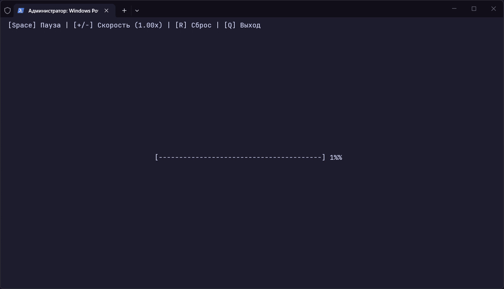

# Animated Console Progress Bar (C++)

**English** | [Русский](README.ru.md)

A lightweight, zero-dependency C++ console progress bar for Windows with dynamic screen centering, speed control, and layout-independent hotkeys.

## Demo



## Task Description

Create an animated console progress bar in C++. A single progress bar in the center of the screen fills from 0% to 100% and resets in a continuous loop. Controls: `Space` to pause, `+/-` to adjust speed, `R` to reset to 0%, `Q` to quit. Only the progress bar line should be redrawn (not the entire screen), displaying the current percentage next to the bar.

## Tech Stack

- **Language:** C++
- **Compiler:** Clang (MSVC ABI) / MSVC
- **Platform:** Windows (Windows Console API)
- **Dependencies:** None (uses only the C++ Standard Library and `<windows.h>`)

## Features & Controls

| Key       | Action                                  |
| :-------- | :-------------------------------------- |
| `Space`   | Pause / Resume                          |
| `+` / `=` | Increase speed by `0.25x`               |
| `-` / `_` | Decrease speed by `0.25x` (min `0.25x`) |
| `R`       | Reset progress to `0%`                  |
| `Q`       | Quit application                        |

## Build & Run

1. Clone the repository:

```bash
git clone https://github.com
cd ConsoleProgressBar
```

2. Compile the project from the root directory into `build`:

**Using Clang:**

```bash
mkdir build
clang++ src\main.cpp -o build\main.exe
```

**Using MSVC:**

```bash
mkdir build
cl /EHsc src\main.cpp /Fo:build\ /Fe:build\main.exe
```

3. Run the application:

```bash
build\main.exe
```

### Quick Build & Run (Single Command)

If the `build` directory already exists, you can compile and run the program in PowerShell with one command:

**Using Clang:**

```powershell
clang++ src\main.cpp -o build\main.exe; build\main.exe
```

**Using MSVC:**

```powershell
cl /EHsc src\main.cpp /Fo:build\ /Fe:build\main.exe; build\main.exe
```
