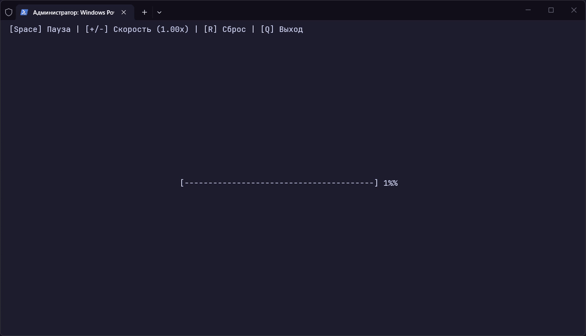

# Анимированный консольный прогресс-бар (C++)

[English](README.md) | **Русский**

Консольное приложение на C++ для Windows без сторонних библиотек, реализующее цикличный прогресс-бар по центру экрана с управлением скоростью, паузой и поддержкой любых раскладок клавиатуры.

## Демонстрация работы



## Описание задачи

Анимированный прогресс-бар. В центре экрана один прогресс-бар заполняется от 0 до 100% и сбрасывается, повторяя цикл. `Space` — пауза, `+/-` — скорость, `r` — сброс в 0%, `q` — выход. Требуется перерисовывать только строку с баром (не весь экран) и показывать текущий процент числом рядом с баром.

## Стек технологий

- **Язык:** C++
- **Компилятор:** Clang (MSVC ABI) / MSVC
- **Платформа:** Windows (Windows Console API)
- **Сторонние библиотеки:** отсутствуют (используются только стандартная библиотека C++ и `<windows.h>`)

## Возможности и управление

| Клавиша   | Действие                                        |
| :-------- | :---------------------------------------------- |
| `Space`   | Пауза / продолжить                              |
| `+` / `=` | Увеличить скорость на `0.25x`                   |
| `-` / `_` | Уменьшить скорость на `0.25x` (минимум `0.25x`) |
| `R`       | Сбросить прогресс в `0%`                        |
| `Q`       | Выход из программы                              |

## Сборка и запуск

1. Клонируйте репозиторий:

```bash
git clone https://github.com
cd ConsoleProgressBar
```

2. Скомпилируйте проект из корневой папки в директорию `build`:

**С помощью Clang:**

```bash
mkdir build
clang++ src\main.cpp -o build\main.exe
```

**С помощью MSVC:**

```bash
mkdir build
cl /EHsc src\main.cpp /Fo:build\ /Fe:build\main.exe
```

3. Запустите программу:

```bash
build\main.exe
```

### Пример запуска одной командой

Если папка `build` уже создана, скомпилировать и сразу запустить программу в PowerShell можно одной командой:

**С помощью Clang:**

```powershell
clang++ src\main.cpp -o build\main.exe; build\main.exe
```

**С помощью MSVC:**

```powershell
cl /EHsc src\main.cpp /Fo:build\ /Fe:build\main.exe; build\main.exe
```
